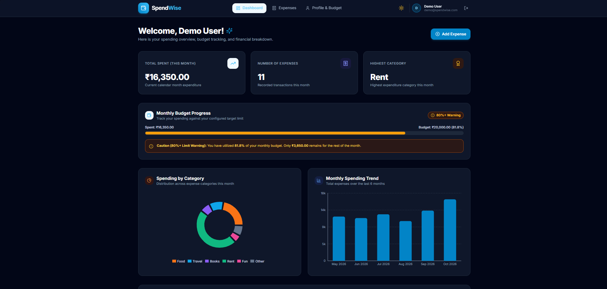
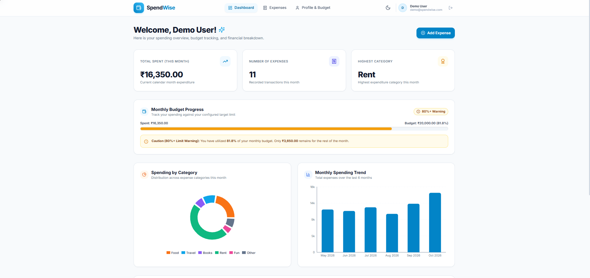
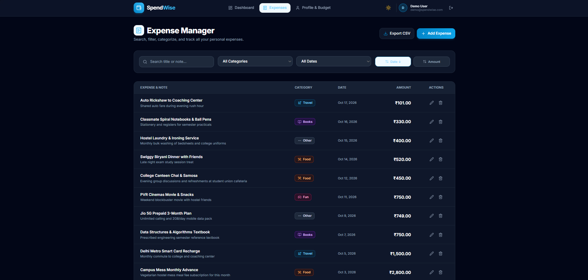
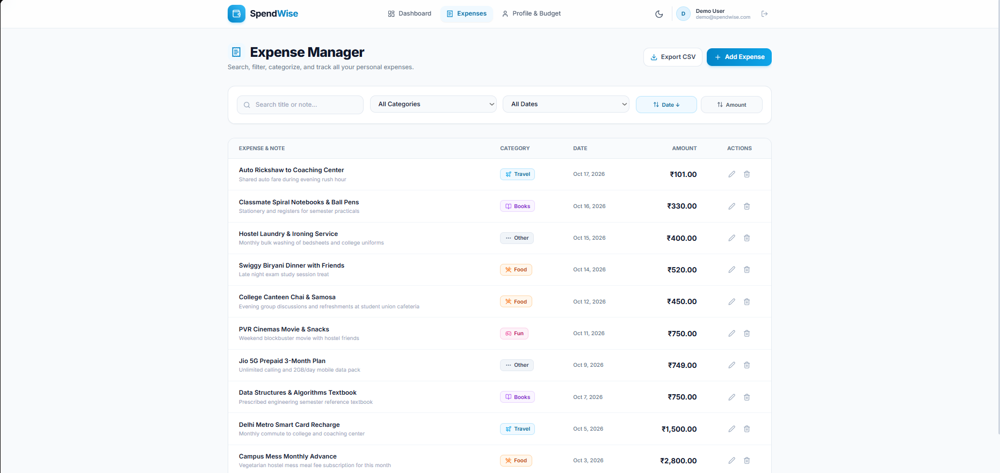
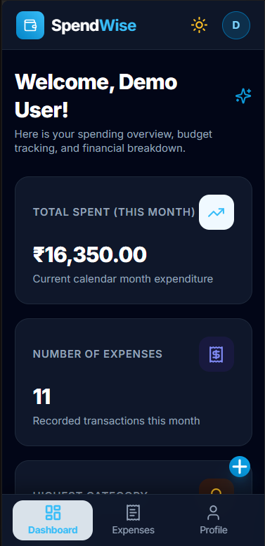

# SpendWise - Expense Tracker

**Live demo:** https://expense-tracker-zeta-five-92.vercel.app

> The server runs on a free plan, so the first load can take about 50 seconds while it wakes up.

A full-stack MERN expense tracker with budgets, charts, search and filters, dark and light themes, and a mobile-friendly layout.

## Demo account

| Email | Password |
|---|---|
| demo@spendwise.com | Demo@123 |

## Screenshots

| Dashboard (dark) | Dashboard (light) |
|---|---|
|  |  |

| Expenses (dark) | Expenses (light) |
|---|---|
|  |  |

**Mobile**



## Features

- Register, login and logout with JWT, kept after refresh
- Private pages: the dashboard and expenses need a login
- Add, edit and delete expenses, with a confirm popup on delete
- Each user sees only their own expenses
- Fixed categories (Food, Travel, Books, Rent, Fun, Other), each with its own color and icon
- Search by title or note, filter by category and date range, sort by date or amount
- Pagination, 10 expenses per page
- Dashboard: total spent this month, number of expenses, top category, category donut chart, monthly bar chart, last 5 expenses
- Monthly budget with a progress bar and warnings at 80% (yellow) and 100% (red)
- Currency picker (INR, USD, EUR, GBP, JPY, AUD, CAD, AED, SGD), formatting only, no conversion
- Export to CSV
- Dark and light themes
- Responsive layout with a bottom tab bar on mobile
- Loading skeletons, toasts and empty states

## Tech stack

- **Frontend:** React (Vite), React Router, Axios, Tailwind CSS, Recharts, Lucide icons
- **Backend:** Node.js, Express, Mongoose
- **Database:** MongoDB Atlas
- **Auth and security:** JWT, bcryptjs, express-validator, CORS

## Project structure

```
client/   React app (pages, components, context, utils, api)
server/   Express API (routes, controllers, models, middleware, config)
```

## Setup

### Requirements
- Node.js 18 or newer
- A MongoDB Atlas cluster (or a local MongoDB)

### 1. Clone
```
git clone https://github.com/Vishant-21/Expense-Tracker.git
cd Expense-Tracker
```

### 2. Server
```
cd server
npm install
```
Copy `.env.example` to `.env` and fill in the values (see the table below), then:
```
npm run seed    # optional: creates the demo account with sample data
npm run dev
```

### 3. Client
```
cd client
npm install
```
Copy `.env.example` to `.env`, then:
```
npm run dev
```
Open http://localhost:5173

## Environment variables

**server/.env**

| Variable | Description |
|---|---|
| PORT | Server port, for example 5000 |
| CLIENT_URL | Frontend URL allowed by CORS, for example http://localhost:5173 |
| MONGO_URI | MongoDB connection string |
| JWT_SECRET | Long random string used to sign tokens |
| JWT_EXPIRES_IN | Token lifetime, for example 7d |

**client/.env**: see `client/.env.example` for the API URL variable.

Never commit `.env` files.

## API routes

All routes except register and login need `Authorization: Bearer <token>`.

**Auth**
- `POST /api/auth/register`
- `POST /api/auth/login`
- `GET /api/auth/me`

**User**
- `PUT /api/users/budget`
- `PUT /api/users/currency`

**Expenses**
- `GET /api/expenses` (search, category, date range, sort and page query options)
- `POST /api/expenses`
- `GET /api/expenses/:id`
- `PUT /api/expenses/:id`
- `DELETE /api/expenses/:id`
- `GET /api/expenses/export` (CSV)

**Dashboard**
- `GET /api/dashboard`

## Roadmap

- Income vs expense type and net balance
- Payment account (Cash, UPI, Card)
- Per-category budgets
- Recurring expenses

## Author

Vishant Barve